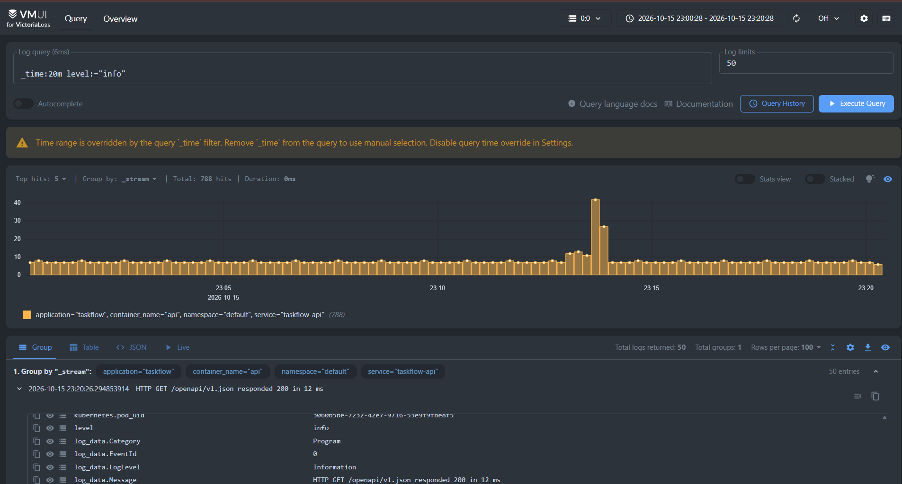
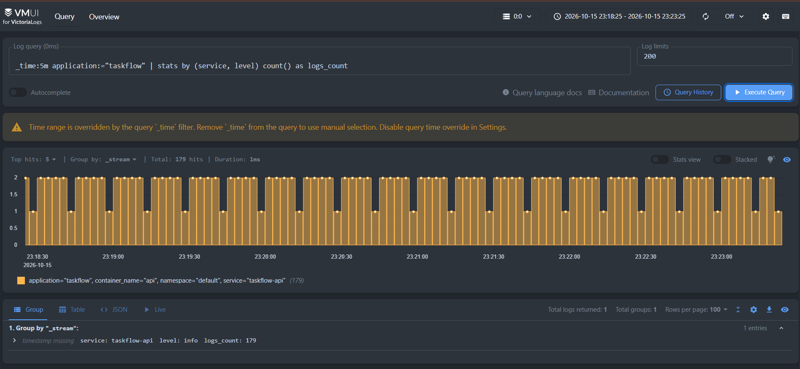
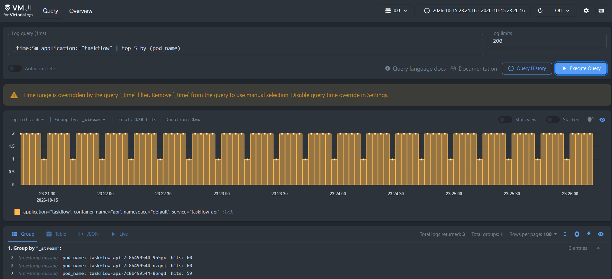
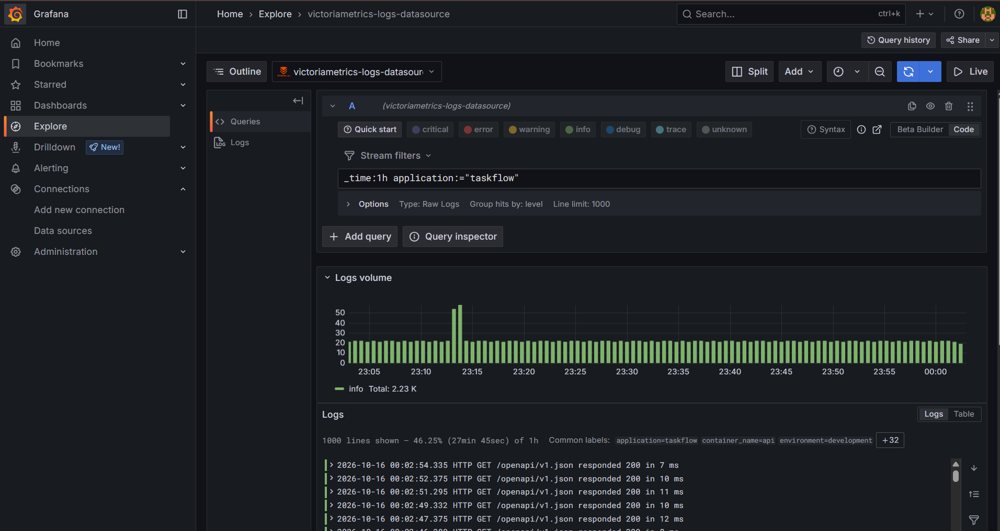

# Отчёт по сбору и анализу логов TaskFlow

## 1. Способ доставки логов

Для централизованного сбора логов приложения **TaskFlow** использован **Vector**, запущенный в Kubernetes в виде **DaemonSet**. Источник `kubernetes_logs` считывает журналы контейнеров с узла кластера. В Vector настроены фильтрация событий, относящихся к сервисам `taskflow-api` и `taskflow-web`, и нормализация полей, включая `application`, `service`, `level` и `pod_name`. Далее события передаются по HTTP в **VictoriaLogs**, где их можно анализировать с помощью LogsQL через веб-интерфейс **vmui**.

Этот способ выбран потому, что DaemonSet позволяет запускать сборщик на каждом узле Kubernetes без изменения кода приложения; Vector поддерживает обработку и фильтрацию логов до отправки, а VictoriaLogs предоставляет единое место хранения и поиска. В данном проекте схема подходит для централизованного анализа журналов API и веб-интерфейса.

## 2. Запросы LogsQL в vmui

### Запрос 1. Сырые записи за последние 5 минут

```logsql
_time:5m
```

Запрос показывает все доступные журнальные записи, поступившие в VictoriaLogs за последние пять минут. Фильтр по приложению отсутствует, поэтому в выборку могут входить логи не только TaskFlow, но и других источников.

**Скриншот 1 — результат первого запроса:**


### Запрос 2. Фильтрация по уровню логирования

```logsql
_time:20m level:="info"
```

Запрос выбирает записи с уровнем `info` за последние 20 минут. Он демонстрирует фильтрацию по структурированному полю `level` и позволяет просмотреть информационные сообщения. Поскольку поле `application` не ограничено, могут отображаться записи разных приложений.

**Скриншот 2 — результат второго запроса:**



### Запрос 3. Группировка по сервису и уровню

```logsql
_time:5m application:="taskflow"
| stats by (service, level) count() as logs_count
```

Запрос анализирует логи TaskFlow за последние пять минут, группирует их по полям `service` и `level` и подсчитывает количество сообщений в каждой группе. Итоговое значение представлено в поле `logs_count`. Это помогает сравнить активность сервисов и распределение сообщений по уровням логирования.

**Скриншот 3 — результат группировки:**



### Запрос 4. Пять самых активных Pod

```logsql
_time:1h application:="taskflow"
| top 5 by (pod_name)
```

Запрос показывает пять значений поля `pod_name`, которые чаще всего встречаются в журналах TaskFlow за последний час. Это позволяет определить Pod, генерирующие наибольшее количество записей.

**Скриншот 4 — результат TOP-5:**



## 3. Бонусное задание. Интеграция VictoriaLogs с Grafana

Подключение к Grafana по http://victoria-logs:9428



## 4. Вывод

В vmui были выполнены четыре запроса LogsQL: просмотр сырых записей, фильтрация по уровню, подсчёт логов с группировкой и поиск наиболее активных Pod. Они демонстрируют возможности централизованного поиска и анализа журналов, поступающих через Vector в VictoriaLogs.