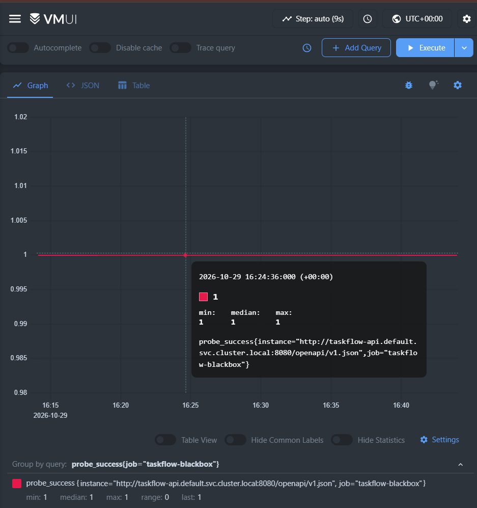

# SLI, SLO и SLA

## 1. Цель работы

Цель работы — на основе метрик TaskFlow организовать оценку доступности и качества работы API, сформулировать SLI, задать целевые значения SLO, определить учебный SLA и отобразить показатели в VictoriaMetrics UI (VMUI).

В проекте используются Kubernetes (Minikube), ASP.NET Core Web API, PostgreSQL, vmagent, VictoriaMetrics Single и Blackbox Exporter.

## 2. Реализованные изменения

1. Развёрнут Blackbox Exporter в namespace `monitoring`.
2. Настроен HTTP-модуль `http_2xx` с тайм-аутом проверки 5 секунд.
3. В Helm-конфигурацию vmagent добавлено задание `taskflow-blackbox` с интервалом сбора 15 секунд.
4. В качестве цели проверки используется `http://taskflow-api.default.svc.cluster.local:8080/openapi/v1.json`.
5. vmagent собирает результат проверки и отправляет метрики в VictoriaMetrics.
6. Проверена работа сбора: `up{job="taskflow-blackbox"} = 1`, `probe_success{job="taskflow-blackbox"} = 1`, HTTP-код `200`.

Blackbox Exporter выполняет HTTP-проверку целевого API по запросу vmagent. `up` показывает, удалось ли vmagent получить метрики экспортёра; `probe_success` показывает результат самой проверки API. Эти показатели не взаимозаменяемы.

## 3. Выбранные метрики

### 3.1. SLI 1 — доступность HTTP API (TBSLO)

**Источник:** `probe_success{job="taskflow-blackbox"}`.

Метрика принимает значение `1`, если HTTP-проверка завершилась успешно, и `0`, если проверка неуспешна. Проверка выполняется примерно каждые 15 секунд.

Формула оценки за период:

`SLI_API = количество успешных проверок / количество всех выполненных проверок × 100%`

Для регулярных проверок с одинаковым интервалом среднее значение `probe_success` является оценкой доли времени доступности. Это дискретная оценка по результатам проверок, а не гарантия обнаружения каждого кратковременного сбоя.

**PromQL для последних 5 минут:**

```promql
avg_over_time(probe_success{job="taskflow-blackbox"}[5m]) * 100
```

**PromQL для последних 7 дней:**

```promql
avg_over_time(probe_success{job="taskflow-blackbox"}[7d]) * 100
```

### 3.2. SLI 2 — успешность HTTP-запросов (RBSLO)

**Источник:** `http_requests_received_total` с метками `app` и `code`.

Успешными считаются ответы с HTTP-кодами `2xx`. Индикатор рассчитывает долю успешных запросов от общего количества учтённых запросов.

Формула:

`SLI_HTTP = количество успешных запросов 2xx / количество всех учтённых HTTP-запросов × 100%`

**PromQL для последних 5 минут:**

```promql
100 *
sum(rate(http_requests_received_total{app="taskflow-api",code=~"2.."}[5m]))
/
sum(rate(http_requests_received_total{app="taskflow-api"}[5m]))
```

### 3.3. SLI 3 — доля быстрых HTTP-запросов (RBSLO)

**Источник:** `http_request_duration_seconds_bucket` и `http_request_duration_seconds_count`.

Показатель определяет долю запросов, время выполнения которых не превышает 256 мс.

Формула:

`SLI_latency = количество запросов длительностью ≤ 256 мс / количество всех измеренных запросов × 100%`

**PromQL для последних 5 минут:**

```promql
100 *
sum(rate(http_request_duration_seconds_bucket{app="taskflow-api",le="0.256"}[5m]))
/
sum(rate(http_request_duration_seconds_count{app="taskflow-api"}[5m]))
```

Метрика основана на гистограмме времени ответа, уже собираемой приложением.

### 3.4. Дополнительный индикатор — доступность PostgreSQL

**Источник:** `pg_up`.

Формула:

`SLI_DB = количество успешных проверок PostgreSQL / количество всех проверок × 100%`

**PromQL для последних 5 минут:**

```promql
avg_over_time(pg_up[5m]) * 100
```

## 4. Целевые значения SLO

Для учебной демонстрации приняты следующие целевые значения. Это проектные цели, а не внешние нормативы.

| Индикатор | Целевое значение SLO | Окно оценки |
|---|---:|---|
| Доступность HTTP API | ≥ 99,5% | 7 дней |
| Успешность HTTP-запросов | ≥ 99,0% | 7 дней |
| Доля запросов ≤ 256 мс | ≥ 95,0% | 7 дней |
| Доступность PostgreSQL (дополнительно) | ≥ 99,5% | 7 дней |

Для расчёта показателей за 7 дней используются соответствующие выражения с диапазоном `[7d]`. 

### Запросы для графиков SLO в VMUI

**Доступность API, 7 дней:**

```promql
avg_over_time(probe_success{job="taskflow-blackbox"}[7d]) * 100
```

**Успешность запросов, 7 дней:**

```promql
100 *
sum(rate(http_requests_received_total{app="taskflow-api",code=~"2.."}[7d]))
/
sum(rate(http_requests_received_total{app="taskflow-api"}[7d]))
```

**Доля запросов ≤ 256 мс, 7 дней:**

```promql
100 *
sum(rate(http_request_duration_seconds_bucket{app="taskflow-api",le="0.256"}[7d]))
/
sum(rate(http_request_duration_seconds_count{app="taskflow-api"}[7d]))
```

**PostgreSQL, 7 дней:**

```promql
avg_over_time(pg_up[7d]) * 100
```

## 5. SLA приложения TaskFlow

Для учебного проекта формулируется следующий SLA:

 Целевая доступность HTTP API TaskFlow составляет не менее 99,0% за период оценки. Доступность определяется по результатам регулярных HTTP-проверок Blackbox Exporter. Настоящая формулировка является учебной моделью SLA, а не действующим коммерческим договором.

Формула доступности:

`Availability = успешные проверки / все выполненные проверки × 100%`

Для условного периода в 7 суток 99,0% доступности соответствует не более чем 100,8 минуты недоступности (при непрерывном семидневном периоде). Из-за проверки с интервалом 15 секунд оценка имеет дискретную точность.

**Ограничение хранения:** текущая конфигурация VictoriaMetrics использует retention `7d`. Поэтому доступность за 7 дней можно оценивать в рамках текущего хранения, но полноценный SLA за календарный месяц нельзя проверить по всей истории, пока срок хранения не будет увеличен как минимум до 30 дней.

## 6. Текущие результаты проверки

По выполненным запросам VMUI на момент проверки получены следующие значения за выбранное короткое окно наблюдения:

| Индикатор | Полученное значение |
|---|---:|
| Доступность API по Blackbox Exporter | 100% |
| Успешность HTTP-запросов | 100% |
| Доля быстрых HTTP-запросов | 100% |
| Доступность PostgreSQL по `pg_up` | 100% |
| HTTP-код Blackbox-проверки | 200 |


Эти значения относятся к моменту и окну проверки; они не подтверждают выполнение SLO за полные 7 дней. Для этого необходимо накопить соответствующую историю метрик.

## 7. Скриншоты графиков VMUI

Добавьте реальные скриншоты из VMUI в каталог `screenshots/` с указанными именами. Включите в скриншот запрос PromQL, график и выбранный диапазон времени.

### 7.1. Доступность API


### 7.2. Успешность HTTP-запросов


### 7.3. Доля быстрых HTTP-запросов


### 7.4. Доступность PostgreSQL


### 7.5. Результат HTTP-probe



## 8. Описание изменений приложения для демонстрации

В код бизнес-логики TaskFlow изменения не вносились. Для мониторинга добавлены отдельный Kubernetes Deployment и Service Blackbox Exporter, ConfigMap с HTTP-модулем `http_2xx`, а в Helm-конфигурацию vmagent добавлено задание `taskflow-blackbox`.


