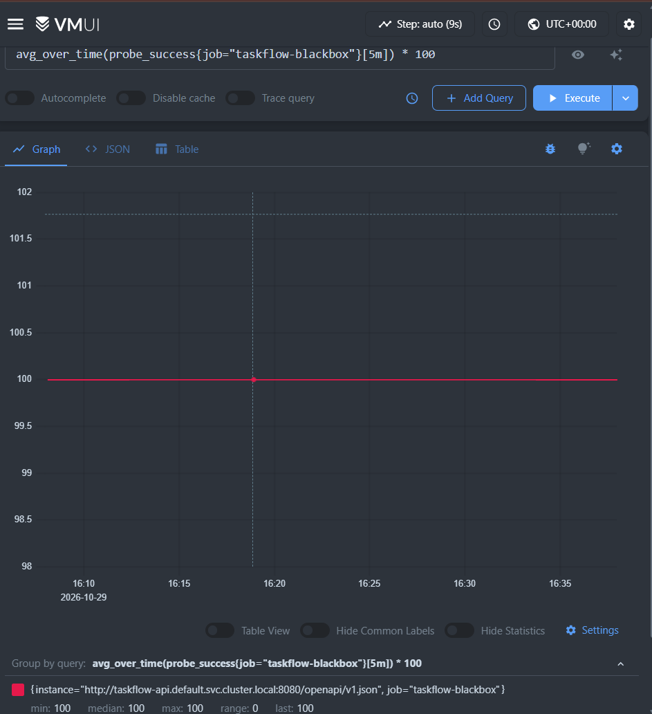
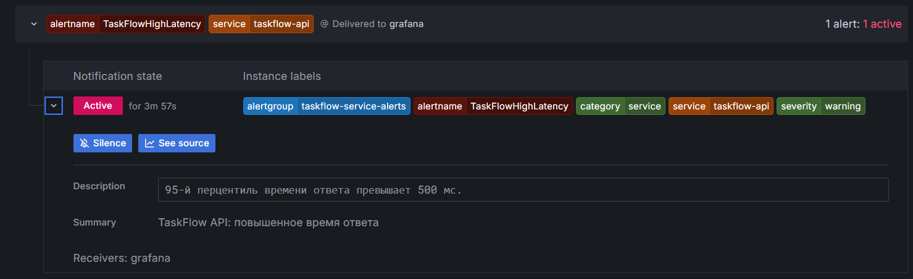
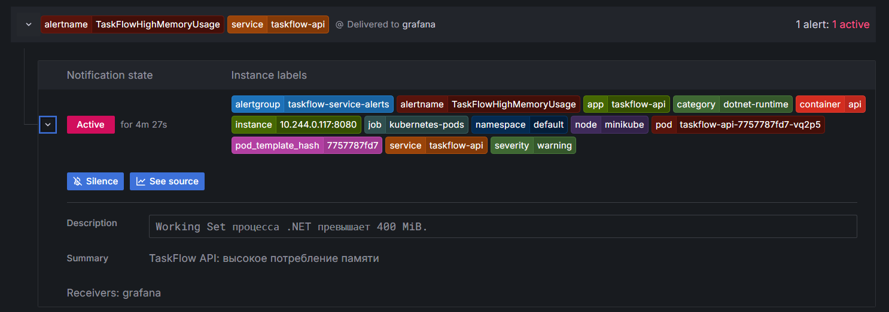
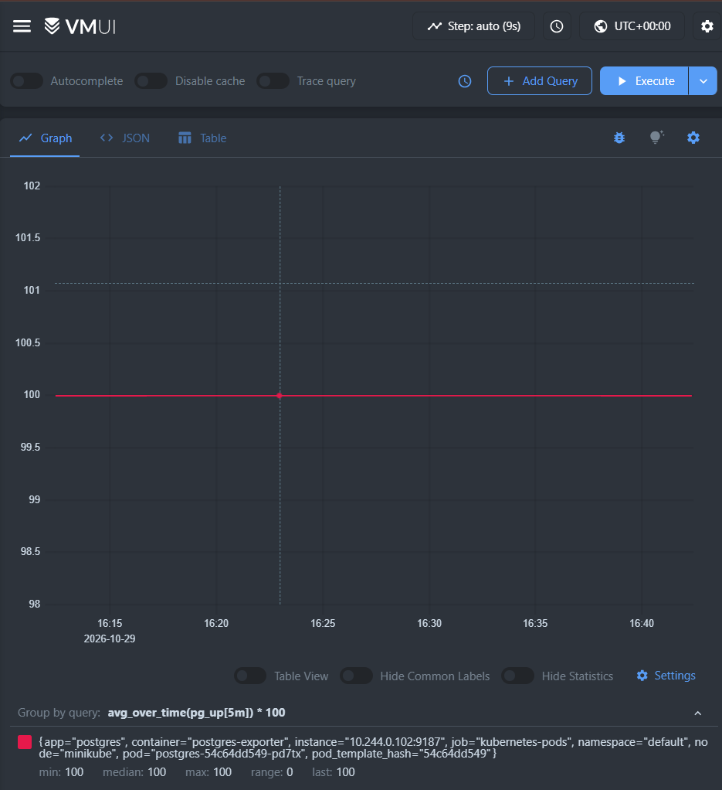

# Алерты

## 1. Цель работы

Разработать систему оповещения для TaskFlow: определить алерты на
HTTP-метрики сервиса и метрики среды выполнения .NET, настроить vmalert
и Alertmanager, подключить Alertmanager к Grafana и проверить
срабатывание правил.

## 2. Разработанные алерты

Созданы четыре правила: два на метрики сервиса и два на метрики .NET
Runtime.

  -----------------------------------------------------------------------------------------------------------------------
  Алерт                          Метрика                                              Условие           `for`
                                                                                      срабатывания      
  ------------------------------ ---------------------------------------------------- ----------------- -----------------
  `TaskFlowHighErrorRate`        `http_requests_received_total`                       Доля HTTP 5xx     2 минуты
                                                                                      больше 5%         

  `TaskFlowHighLatency`          `http_request_duration_seconds_bucket`               p95 времени       5 минут
                                                                                      ответа больше 500 
                                                                                      мс                

  `TaskFlowHighMemoryUsage`      `system_runtime_dotnet_process_memory_working_set`   Working Set       5 минут
                                                                                      процесса больше   
                                                                                      400 MiB           

  `TaskFlowThreadPoolOverload`   `system_runtime_threadpool_queue_length`             Очередь           2 минуты
                                                                                      ThreadPool больше 
                                                                                      50 задач          
                                                                                      
  -----------------------------------------------------------------------------------------------------------------------

### 3.1. TaskFlowHighErrorRate

Контролирует долю серверных HTTP-ошибок 5xx среди всех запросов. Порог
более 5% выбран для обнаружения ошибок backend и сбоев зависимостей,
влияющих на пользователей.

### 3.2. TaskFlowHighLatency

Контролирует 95-й перцентиль времени ответа. Порог 500 мс выбран для
обнаружения устойчивого ухудшения производительности, которое может быть
незаметно при оценке только среднего времени ответа.

### 3.3. TaskFlowHighMemoryUsage

Контролирует Working Set процесса .NET. Порог 400 MiB выбран как
предупредительный уровень для выявления повышенного потребления памяти.
Это не Kubernetes memory limit: в текущем Deployment TaskFlow API лимит
памяти явно не задан.

### 3.4. TaskFlowThreadPoolOverload

Контролирует длину очереди .NET ThreadPool. Порог более 50 задач
позволяет обнаруживать накопление ожидающей работы, которое может быть
связано с блокирующими операциями или повышенной нагрузкой.

## 4. Проверка срабатывания

Для демонстрации прохождения алертов по цепочке
`vmalert → Alertmanager → Grafana` применялось контролируемое
тестирование: временно изменялись пороговые значения существующих
правил. После проверки рабочие пороги были восстановлены.

Такое тестирование подтверждает работу механизма алертинга, но не
означает, что в ходе теста обязательно возникла реальная
эксплуатационная авария или были превышены исходные рабочие пороги.

### 4.1. TaskFlowHighErrorRate

### 4.2. TaskFlowHighLatency

### 4.3. TaskFlowHighMemoryUsage

### 4.4. TaskFlowThreadPoolOverload

