# Метрики

## 1. Цель работы

Развернуть VictoriaMetrics в Minikube и настроить сбор метрик приложения
TaskFlow и PostgreSQL по модели **Pull**. Проверить доступность метрик в
VictoriaMetrics UI (VMUI).

## 2. Стек и экспортеры

-   **Minikube / Kubernetes** --- запуск приложения и компонентов
    мониторинга.
-   **Helm** --- установка VictoriaMetrics.
-   **VictoriaMetrics Single** --- хранение временных рядов и выполнение
    запросов.
-   **VictoriaMetrics Agent (`vmagent`)** --- обнаружение Pod через
    Kubernetes Service Discovery, сбор метрик и передача их в
    VictoriaMetrics.
-   **TaskFlow API (ASP.NET Core)** --- экспорт метрик приложения по
    адресу `/metrics` на порту `8080`.
-   **PostgreSQL 16** --- база данных TaskFlow.
-   **postgres-exporter `v0.20.1`** --- экспорт метрик PostgreSQL по
    адресу `/metrics` на порту `9187`.
-   **Kubernetes Secret `taskflow-db-secret`** --- хранение параметров
    подключения к базе данных.

Для обнаружения целей используются аннотации Pod `prometheus.io/scrape`,
`prometheus.io/port` и `prometheus.io/path`.

## 3. Реализованные бизнес-метрики TaskFlow

  Метрика                             Описание
  ----------------------------------- -----------------------------------
  `taskflow_tasks_created_total`      Количество успешно созданных задач

  `taskflow_tasks_completed_total`    Количество задач, переведённых в
                                      состояние Done

  `taskflow_projects_created_total`   Количество успешно созданных
                                      проектов

  `taskflow_comments_created_total`   Количество успешно созданных
                                      комментариев

  `taskflow_users_created_total`      Количество успешно созданных
                                      пользователей

Метрики являются счётчиками (`counter`) и увеличиваются при выполнении
соответствующих успешных операций. Также проверяются технические метрики
приложения и метрики PostgreSQL, предоставляемые экспортерами.

## 4. Проверка развёртывания

``` powershell
kubectl get pods -n monitoring
kubectl get svc -n monitoring
helm list -n monitoring
```

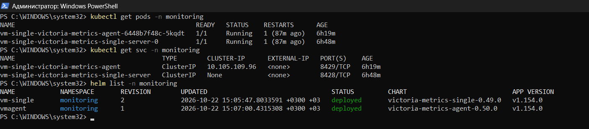

## 5. Проверка сбора метрик

``` powershell
kubectl port-forward svc/vm-single-victoria-metrics-single-server -n monitoring 8428:8428
```

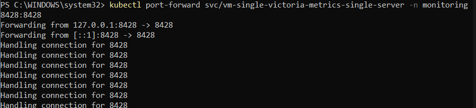

``` powershell
kubectl port-forward svc/vm-single-victoria-metrics-agent -n monitoring 8429:8429
```

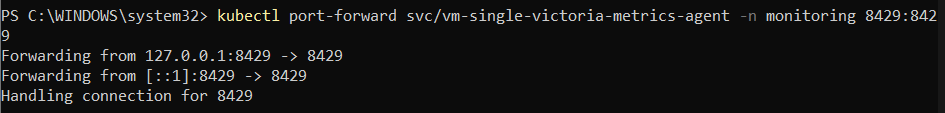

Проверка доступных имён метрик и статуса сбора:

``` powershell
curl.exe "http://localhost:8428/api/v1/label/__name__/values"
```

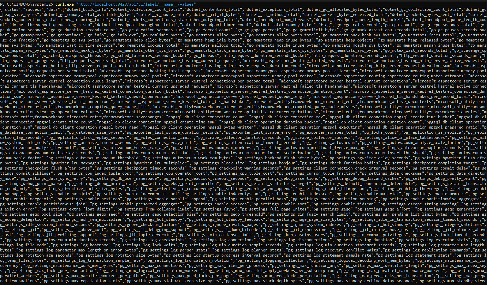

``` powershell
curl.exe "http://localhost:8428/api/v1/query?query=up"
```

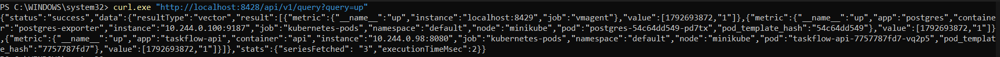

``` powershell
curl.exe "http://localhost:8429/metrics"
```

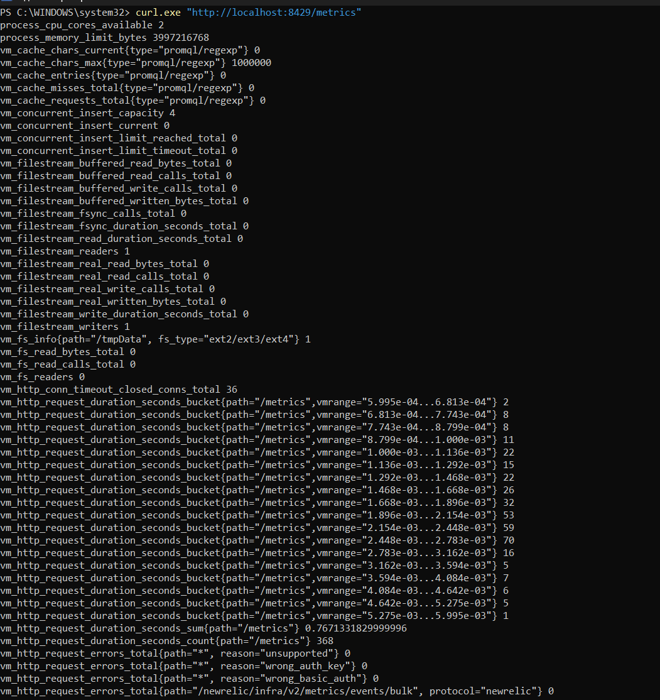

## 6. Запросы в VMUI для демонстрации

### 6.1. Все бизнес-метрики TaskFlow на одном графике

``` promql
{__name__=~"taskflow_(tasks_created|tasks_completed|projects_created|comments_created|users_created)_total"}
```

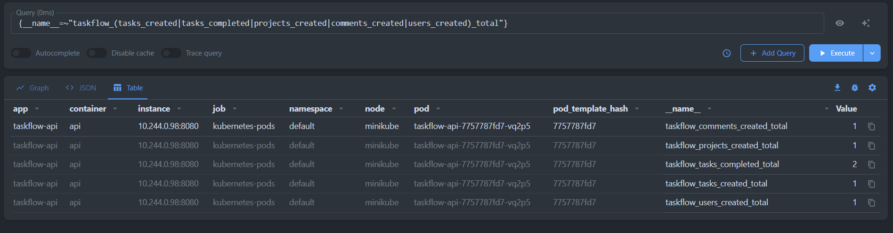

### 6.2. Скорость выполнения бизнес-операций за последний час

``` promql
sum by (__name__) (
  rate({__name__=~"taskflow_(tasks_created|tasks_completed|projects_created|comments_created|users_created)_total"}[1h])
)
```

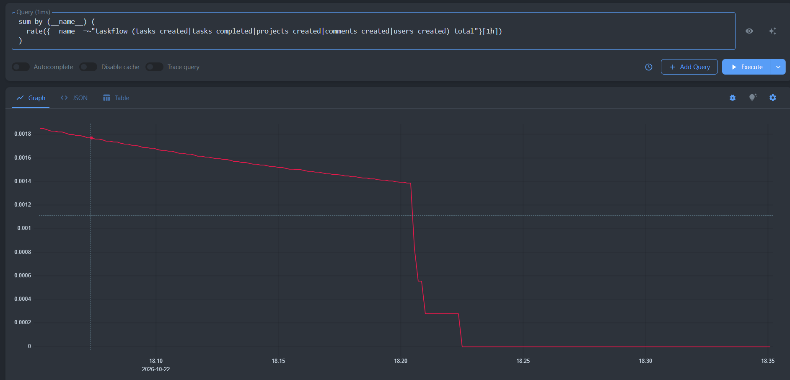

### 6.3. Проверка метрик .NET Runtime

``` promql
{__name__=~"dotnet_.*"}
```

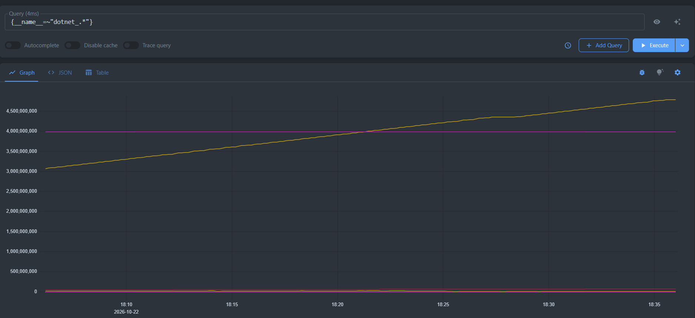

### 6.4. Проверка подключения к PostgreSQL

``` promql
pg_up
```

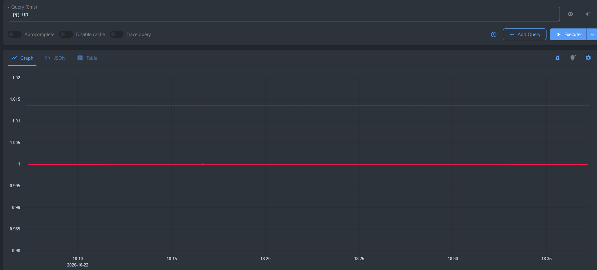

Количество подключений по базам:

``` promql
pg_stat_database_numbackends
```

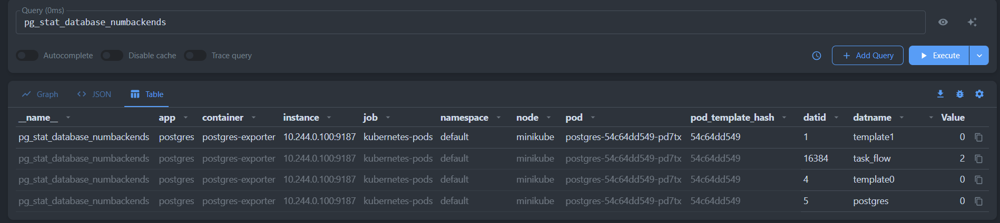

Скорость подтверждённых транзакций:

``` promql
sum by (datname) (rate(pg_stat_database_xact_commit[1h]))
```

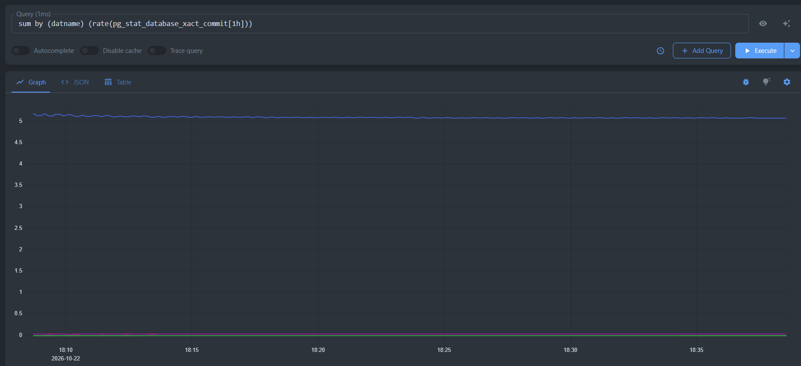

Скорость откатов транзакций:

``` promql
sum by (datname) (rate(pg_stat_database_xact_rollback[1h]))
```

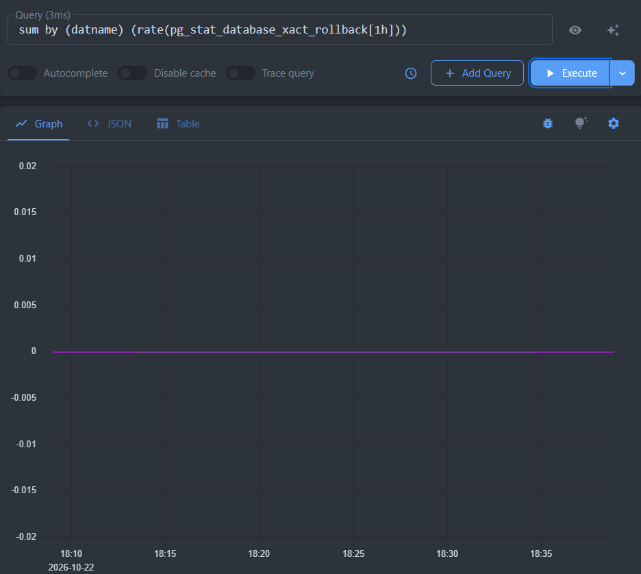

### 6.5. Поиск метрик HTTP

``` promql
{__name__=~"http_.*"}
```

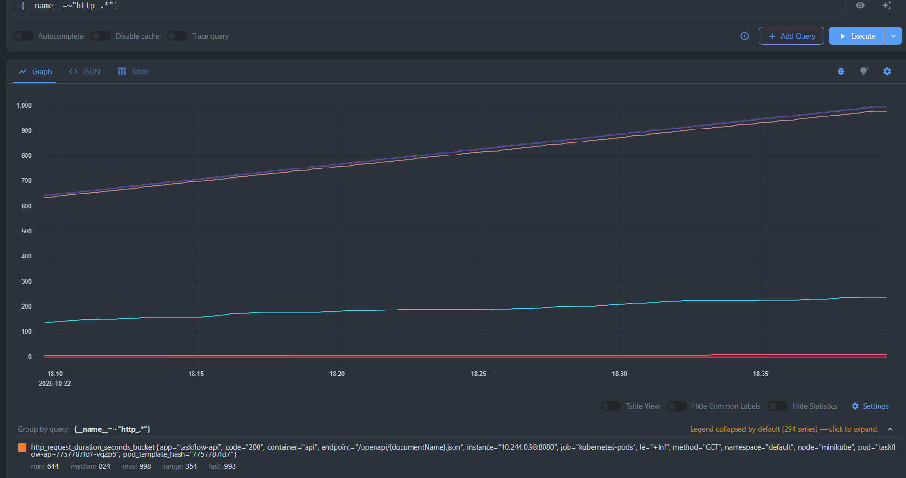


